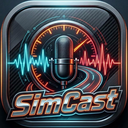

<p align="center"></p>

# SimCast: live TV commentary for your sim race (Windows 10/11)

SimCast gives your sim race the television treatment. While you drive, a commentary booth calls the race live
in your headphones: the start, overtakes anywhere in the field, battles, pit stops, fastest laps, cars in
trouble, the final lap and the finish. It covers **the whole race**, not just you, and follows your race the
way a broadcast follows a driver in the story. Rally stages get rally coverage, against the clock.

SimCast is a standalone Windows app. It's built on the foundation of [SimCoach](https://github.com/Jcedwar61/SimCoach)
(the live voice coach), but **doesn't need SimCoach installed**. The two run side by side without talking over
each other: while SimCoach's coach or crew speaks, the booth drops under them and comes back up after
(*Settings → Voices → When SimCoach talks*; SimCoach 6.13 or later).

### Download
* **[Download SimCast-Setup.exe](https://github.com/Jcedwar61/SimCast/releases/latest/download/SimCast-Setup.exe)**
  (Windows 10/11, 64-bit): a standard setup wizard. No admin rights needed. It installs SimCast for your
  Windows account, then gets Python and SimCast's packages (a few minutes, once). Start menu and desktop
  shortcuts; uninstall from *Settings → Apps* (your settings are kept). If Windows SmartScreen appears,
  choose *More info → Run anyway* (the app isn't code-signed). SimCast tells you when a newer release is out
  and can install it for you.
* **[Latest release and checksums](https://github.com/Jcedwar61/SimCast/releases/latest)**
* **Linux / Steam Deck:** [install-simcast-wine.sh](install-simcast-wine.sh) installs SimCast into the sim's
  own Proton prefix (see below).

### What's new in 1.7
* **Race name:** type the event's name in *Settings → Booth* and the booth announces the race by it, along with
  the track: *"Hello and welcome to the 2026 Las Vegas Grand Prix, here at Las Vegas Strip Circuit..."* They
  name it again when they call the winner and the result, the AI booth works it in, and the race recap is named
  after it. Leave it empty and they just use the track.

### What's new in 1.6
* **New licence:** SimCast is now licensed under the [PolyForm Noncommercial License 1.0.0](LICENSE) instead of MIT. It stays free to use, share and change for any noncommercial purpose; commercial use needs the author's permission. Nothing else changes.

### What's new in 1.5
* **A booth with a personality you choose:** *Settings → Commentary → Style* sets the whole feel in one click:
  **TV broadcast**, **Late-night stream** (looser, chattier, the odd swear word) or **Mates down the pub**
  (unhinged, sweary, all about you). *Fine-tune* has the details: personality (Professional, Loose, Unhinged),
  swearing on or off, how often they wander into random conversations, how chatty, who they follow.
* **Emotion:** every line has a feeling from the racing and the conversation: excited at a pass, angry at a clumsy
  lunge, gutted when a race ends early, tense in a close fight, amused or annoyed at each other. The voices change
  pace, pitch and volume to match; OpenAI voices are told how to say each line, and the new **ElevenLabs** voices
  (your key) get the mood as an emotion cue.
* **Driving mode:** the booth holds back while you brake into a corner, race a car within a second or go off,
  stops a side conversation when someone gets alongside, and catches up on the next straight. *Stream* is the
  full show.
* **Hotkeys on your wheel:** a key or a wheel/button-box button for Skip this line, Booth on/off air, Talk about
  me and Driving/Stream (*Settings → Sims*).
* **The booth remembers:** results, wins and streaks, contact and lead changes between drivers, and each
  commentator's prediction record are kept between races: *"These two made contact at Spa last time out."*
* **League roster:** a spreadsheet with each driver's number, team, pronouns, sponsors and how to say their name:
  *"the number 12 Porsche"*. Without one, drivers are "he" or "she" when the first name makes it clear and "they"
  when it doesn't.
* **Sponsors:** the race's title sponsor, yours and other drivers' (or made-up ones), worked in the way TV
  booths do.
* **More from the sims:** iRacing's temperatures, sky, track wetness, car numbers, teams, tyres and incident
  points; Le Mans Ultimate and rFactor 2's temperatures, cloud, tyres, car numbers and penalties; ACC's car
  numbers. Your fuel per lap is worked out, and the AI argues strategy with all of it.
* **Real AI conversation:** quiet spells wait for the AI instead of a stock line, and a good conversation runs on
  for a few exchanges. A **second AI** (DeepSeek, Gemini or OpenAI) can write the conversations while the first
  answers the big moments, and each job gets the right model automatically: the quickest for reactions, the best
  writer for conversations. Reactions are **streamed**: the first line is spoken while the AI is still writing
  the rest. *Settings → AI* shows a **rough cost** per race.
* **For streamers** (*Settings → Stream*): captions as an **OBS browser source**; the booth **answers Twitch chat**
  in its own words (read without logging in, never read out word for word); and a **post-race recap** with the
  result, **YouTube chapters**, highlights and the full timestamped transcript.
* **Fixes:** every pit stop is timed now (the pit lane compared stops only against the ones called on air); the
  captions window grows to fit long lines.

### What's new in 1.4
* **Updates itself:** SimCast checks GitHub for a newer release when it starts and every 12 hours. A new version
  shows a bar at the top of the window: *Install update* downloads the setup wizard, checks it against the SHA-256
  published for the release and runs it (it closes SimCast and updates it in place; your settings are kept).
  *What's new* opens the release notes and *Not now* skips that version. Nothing is installed until you click.
  *Settings → About* has the switch and a *Check now* button.
* **SimCoach from the setup wizard:** SimCast-Setup.exe has a new option, *SimCoach: live voice coach and race
  crew* (unticked). Tick it and setup also installs the latest [SimCoach](https://github.com/Jcedwar61/SimCoach)
  from its GitHub release, checked against the published SHA-256 before it runs. The two stay separate apps.
* **One voice model for both:** if SimCoach has already downloaded the Kokoro voice model (about 115 MB), SimCast
  uses that copy instead of downloading it again, and the other way round. Python and the packages were shared
  already.
* **Ready for newer SimCoaches:** the link that drops the booth under the coach now understands newer versions of
  SimCoach's message as well as today's, so updating one app never breaks the other.

### What's new in 1.3
* **A booth with opinions:** Ben and Kate make calls on the fights in front of them, with a reason from the lap
  times, and the other one pushes back. *"I think Okafor keeps this. Okafor was four tenths faster last time
  round."* *"I don't know. Okafor has had a mirror full of Lindqvist for a while now. Mistakes come from that."*
* **And they remember them:** a prediction stays on the record until the race settles it, mid-race or at the flag:
  *"All right, Kate, you called that one."* *"I'm only going to mention it once."* A call that's slow to come off
  gets a bit of stick (*"How's that prediction looking?"*), and a fight decided by a pit stop or a spin credits nobody.
* **Answers that add something:** instead of stock remarks, the second voice brings a number: who was quicker on the
  last lap and by how much, laps left, places gained since the grid. The same fact isn't given twice running.
* **Mia is part of the booth:** the big stops are thrown down to the pit lane by name, and Mia times every stop and
  compares it to the best so far, answers the booth's questions, argues strategy with Kate and hands back. Several cars pitting at
  once are one report from the lane, not a string of single lines.
* **Side conversations:** between stories the booth drifts off the way a real one does, but always about what's on
  screen: what it's like in the car with someone filling your mirrors, the race in numbers, who Kate would swap seats
  with, who wins it (with dinner riding on it), what it's like in the pit lane during a stop, what you should be
  thinking from your place. Each one at most once a race, and never in the opening scramble, the last lap or a caution.
* **Callbacks:** the booth ties the race together (*"That's the car that gained two places at the start, Ben."*).
* **AI booth:** a new brief built on how IMSA, GT World Challenge and WEC booths talk. The AI sees the calls on record
  and the stop times, and quiet spells take different shapes: a real question answered with a number, a debate, a
  callback, a throw to the pit lane, or a side conversation.
* **Earlier:** a booth that works a story between two voices with very little dead air (1.2), and runs alongside
  SimCoach, dropping under the coach or crew while they talk (1.1; *Settings → Voices → When SimCoach talks*).

### The booth
* **Ben, the lead commentator**, calls the action and runs the show: *"And Okafor takes the lead! Past Moretti, and
  into first place!"*
* **Kate, the analyst**, a former racing driver with opinions: *"No surprise, really. Okafor was three tenths a lap
  quicker than Moretti coming into that."*
* **Mia, the pit-lane reporter**, brings you every stop, and talks back: *"Moretti is back out, in seventh,
  thirty-one seconds in the pit lane. That's one point four seconds slower than Carter's stop, which is still the
  one to beat."*

They work a story the way a television booth does: it gets opened, argued over, followed while it lasts and paid
off when it breaks, with somebody usually proved right. Nobody holds the floor for long, and there is always
another thread running somewhere in the field.

Names and voices are yours to change. Each speaks in their own voice and gets faster, higher and louder as the
moment gets bigger; when something big happens, the lead cuts in, the way it does on TV.

### Every sim SimCast supports
| Sim | Coverage |
| --- | --- |
| Le Mans Ultimate, rFactor 2, iRacing, Automobilista 2, RaceRoom | the whole field |
| F1 25 | the whole field, plus the game's own collisions, penalties and safety car |
| ACC | the whole field, through ACC's broadcasting API (SimCast switches it on), plus ACC's accident events |
| Assetto Corsa | the whole field with the CrewChiefEx app, else your car |
| AC EVO | your car (it doesn't share the others) |
| EA SPORTS WRC, DiRT Rally 2.0, AC Rally | rally stages: splits against your best run on that stage, moments, damage, the stage time and new bests |

iRacing also gives the booth the temperatures, sky, track wetness, car numbers, teams, tyres and incident points;
Le Mans Ultimate and rFactor 2 the temperatures, cloud, tyres, car numbers and penalties; ACC the car numbers.

SimCast **finds the sims installed on your PC** (every Steam library, iRacing, EA app installs) and lists them on
its start screen, each marked ready or with the one thing still to do. It picks the coverage by itself. *Your car only* means TV-style coverage of your session: places gained
and lost, the gap to the car ahead closing, pressure from behind, trips off the track, your laps and the finish.
For the sims you have installed, SimCast switches on what they need (EA WRC, DiRT Rally 2.0 and F1 25 telemetry,
ACC's broadcasting port, Assetto Corsa's CrewChiefEx app), backing up what it changes. The one setting it can't
make (Automobilista 2's shared memory) is in the built-in guide.

### Voices (free, like SimCoach's)
* **Microsoft neural voices**: natural and quick; the default.
* **Kokoro**: high-quality neural voices that run on your PC, offline after a one-time download.
* **Google** voices.
* **OpenAI** voices (with your OpenAI key): every line is spoken with its own direction and feeling.
* **ElevenLabs** voices (with your ElevenLabs key): the voices on your account, the most emotional of all; each
  line's mood goes in as a cue (*[excited]*, *[sighs]*, *[laughs]*).

The free voices can only change pace, pitch and volume, so "angry" mostly sounds faster and louder; OpenAI and
ElevenLabs voices carry real emotion.

Pick a voice for each commentator, and where it plays: **Settings → Voices → Play on** (headset, speakers,
VR headset). If a voice's service can't be reached, the line is spoken by Kokoro, then Google, then Windows'
own voice: the booth never goes silent.

### AI commentary (optional)
The booth calls every moment from its own lines, instantly. Add an **OpenAI, Google Gemini or DeepSeek** key
(Settings → AI) and the booth writes its own conversation from the live race: the analyst answers the lead's
calls and argues with them, the pit reporter is brought in when the stops are the story, quiet spells become a real
back-and-forth (a debate, a question, a side conversation), predictions are remembered and settled, and there's a
proper sign-off. With two keys, a **second AI** writes the conversations while the first answers the big moments
(*Settings → AI → Conversations*; Automatic uses DeepSeek when it has a key). **Models are picked automatically**
for each job: the quickest good one for reactions (streamed, so the first line is spoken while the rest is still
being written) and the strongest writer for conversations; you can choose another from the list. With more than
one key, it moves to another provider if one is down. The AI only gets the race data, the booth's memory of
earlier races and strict rules: no invented facts, drivers by name, no repeats. *Settings → AI* shows a rough cost
for the race so far.

### Built-in guide
The **Guide** button opens a guide to everything: getting started, setting up each sim, voices and sound, AI,
every setting, streaming, Linux and troubleshooting. It opens by itself the first time.

### Streaming
* **OBS captions** (*Settings → Stream*): a page on your PC for a Browser source, transparent, each line in the
  speaker's colour. Or tick **Captions window** for a small always-on-top window that grows to fit each line.
* **Twitch chat:** type your channel and, with an AI key, the booth answers the odd message in a quiet spell, in
  its own words (*"Kate, someone in chat says you're wrong"*). Chat is read without logging in, nothing is
  posted, and abuse, spam, links and attempts to make the booth say something are ignored.
* **Recap:** after each race, a file with the result, YouTube chapters ready to paste, the highlights and the
  whole transcript, timestamped from lights out (plus an offset for when your stream started).
* Add the *Play on* device to OBS to put the booth on stream; *Driving* mode keeps it out of your way when you're
  the one racing.

### Linux and Steam Deck
Sims share their live data inside their own Wine prefix, so SimCast must run in the same prefix as the game:
```
./install-simcast-wine.sh --game lmu        # or --appid N for any Steam game, or --prefix DIR for plain Wine
./install-simcast-wine.sh --list            # the known sims
```
It finds the game's Proton prefix and Proton build, installs SimCast there silently, and makes
`~/.local/bin/simcast-<game>.sh` plus a menu entry. Start the game, then SimCast. The installer needs no
PowerShell (SimCast.exe gets uv, Python and the packages itself). The script opens the same setup wizard as on
Windows (`--silent` skips it). Under Wine the Kokoro voices are off (NumPy can crash some Wine versions;
`SIMCAST_WINE_KOKORO=1` switches them on); the Microsoft, Google and OpenAI voices work.

## For developers
```
sim_cast.py                  entry point (--demo, --console, --test, --no-voice, --setup)
simcast/sims.py              the sim readers (adapted from SimCoach) with the whole field (Frame.field)
simcast/acc_broadcast.py     ACC's broadcasting API client
simcast/race.py              the race model: timing loops, gaps, overtakes, battles, pit stops, incidents
simcast/solo.py              one-car coverage and rally stages (best runs in %APPDATA%\SimCast\stages.json)
simcast/director.py          what goes on air, when, and what gets cut off
simcast/writer.py            the instant lines, in three voices
simcast/ai.py, providers.py  the AI booth; OpenAI / Gemini / DeepSeek, a model for each job, streamed reactions
simcast/persona.py, banter.py  pronouns, personality, emotion, sponsors, outbursts and random conversations
simcast/cockpit.py           driving mode: quiet while the driver is busy
simcast/hotkeys.py           keyboard and wheel-button hotkeys
simcast/memory.py, roster.py  the booth's memory across races; the league roster (CSV)
simcast/stream.py, recap.py  OBS captions page, Twitch chat; the post-race recap
simcast/eleven.py, usage.py  ElevenLabs voices; the cost estimate
simcast/audio.py             voices (Microsoft, Kokoro, Google, OpenAI, ElevenLabs), fallback, playback, interruptions
simcast/detect.py            the supported sims installed on this PC (Steam libraries, iRacing, EA app)
simcast/gamesetup.py         EA WRC, DiRT Rally 2.0, F1 25, ACC and Assetto Corsa set up for SimCast
simcast/gui.py, guide.py     the window, settings, captions window, the guide
simcast/update.py            the update check and the checksum-verified installer download
simcast/link.py              the SimCoach link (the booth drops under the coach)
simcast/demo.py              a fictional 12-car race for the demo and the tests
simcast/licenses/            SimCast's MIT licence and third-party notices
tools/launcher/              SimCast.exe (Go): build_launcher.sh
installer-source/            SimCast-Setup.exe (NSIS, 64-bit): tools/installer/build_installer.sh
```
Tests: `tools/run_tests.sh` (add `--gui` for the real window under Xvfb);
`tools/installer/wine_check.sh` installs, runs and uninstalls SimCast under Wine.

Build: `tools/launcher/build_launcher.sh` (Go and go-winres), then `tools/installer/build_installer.sh` (NSIS and
7-Zip). On Windows, `tools/installer/nsis64.ps1` fetches a 64-bit NSIS (the setup and the winget package are x86-only)
and prints the folder for PATH.

Releasing: set `APP_VERSION` in `simcast/app.py`, add a "What's new" section here, run the tests, build the
launcher and the installer, merge to main, then publish a GitHub release tagged `vX.Y` on main with
**SimCast-Setup.exe** attached under exactly that name: installed copies' update check and SimCoach's setup wizard
both look for it, and both check the download against the SHA-256 GitHub shows for the asset.
